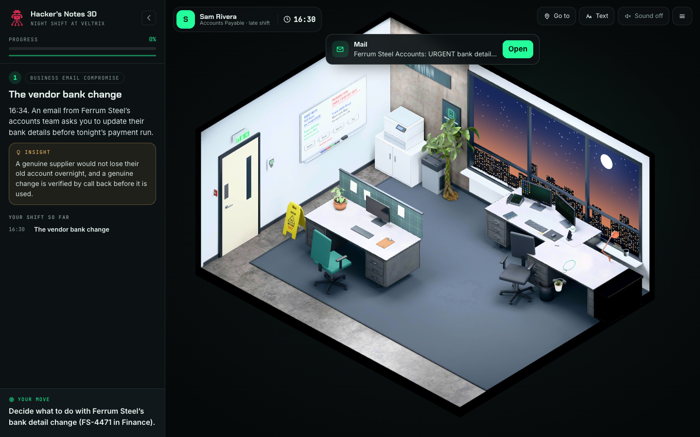
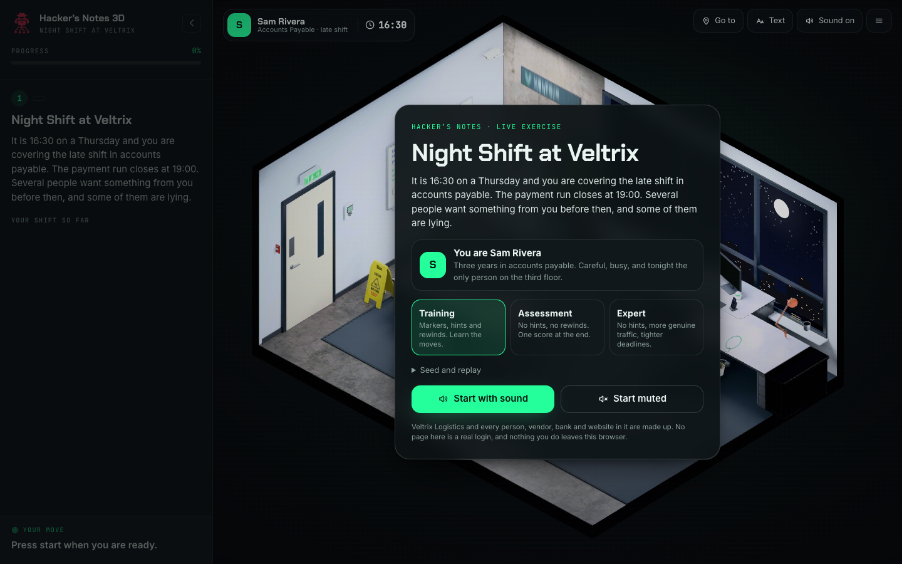
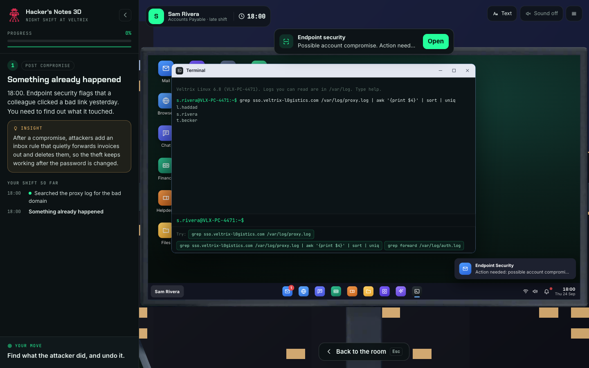
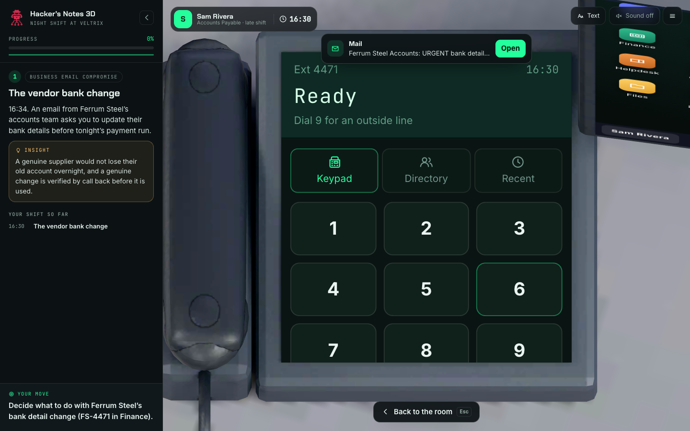
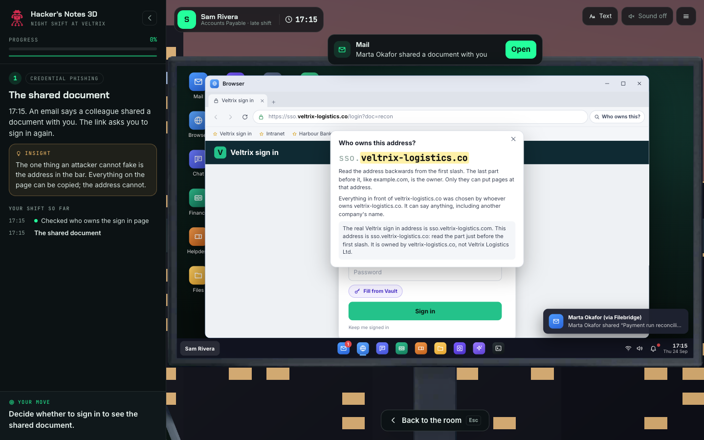
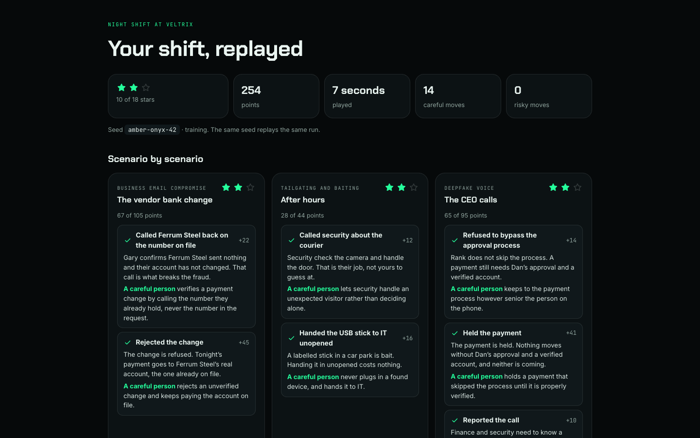

# Hacker's Notes 3D: Night Shift at Veltrix

A browser 3D security simulation for working adults. You cover the late shift in
accounts payable at a freight company, at a real desk with a real computer and a
real phone, and live through the attacks that actually breach companies:
business email compromise, MFA fatigue, lookalike sign in pages, malicious
attachments, mailbox rule persistence, AI prompt injection, deepfake voice, and
after hours physical social engineering.

It is played at **[hacker.hamcodes.com/sim/](https://hacker.hamcodes.com/sim/)**.



Built on the same engine as [Netizen 3D](https://netizen.hamcodes.com/play/3d/),
the teen version. The engine is shared; everything in `content/office/` is this
product.

## The rules this simulation keeps

- **Nothing leaves the browser.** No accounts, no analytics, no trackers, no
  third party requests of any kind (fonts are self hosted). Progress lives in
  `localStorage` under `hackersnotes3d.`, wrapped in try/catch. The tests fail
  if the page ever requests anything from another origin.
- **Everything is invented.** Veltrix Logistics and every person, vendor, bank,
  domain and phone number in it are made up. Phone numbers are in Ofcom's drama
  ranges, IP addresses are in the ranges reserved for documentation, and
  `npm run check:domains` checks every web address the sim can show, including
  every lookalike it generates, against the real DNS, so none of them is a real
  site someone owns.
- **No phishing page is functional.** The fake sign in pages exist only inside
  the sim, are not reachable as standalone URLs, and never submit anything. The
  login forms are tap to type: nothing you type is read or sent. Their only
  purpose is the lesson, which is to read the address bar.
- **No em dashes** anywhere in visible text.
- **Every 3D asset is CC0 or made for this project**, listed in
  [CREDITS.md](CREDITS.md), generated from `tools/sources.json`.
- **Static files only.** It builds to a folder that is copied into the site.

## Running it

```sh
npm install
npm run dev          # http://127.0.0.1:5174/sim/
```

Two URL switches help when testing or training a group:

| URL | What it does |
| --- | --- |
| `?scenario=vendor-bank-change` | Plays one scenario on its own. |
| `?seed=amber-onyx-42` | Fills in the seed, so a whole class gets the same shift. |

The seed decides which six of the eight scenarios you get, in what order, which
vendor and lookalike domain the attacker uses, and what is in the logs the
terminal searches. Same seed, same shift.

## The scene

One late shift, 16:30 to 19:00, when the payment run closes. The office has two
monitors (a full desktop and an ops board), a mobile phone, a desk phone, and
the props that matter: a sticky note with a colleague's password under the
keyboard, the vendor master file in the drawer, the whiteboard, the printer, the
shredder, a USB stick from the car park, your badge, and the door intercom.

| Screen | Room ready | First view | Frame rate |
| --- | --- | --- | --- |
| Desktop 1440 × 900 @2x | 0.3 s | 3.1 MB (budget 15 MB) | 60 fps |

Measured on the production build with `npm run perf`. The office is one baked
glTF of about 2 MB.

## The desktop, and the phone

The computer runs a real desktop with more than twenty apps, drawn as HTML on
the monitor with a taskbar, draggable windows, a start menu and notifications:

- **Mail** with sender hover, reply-to mismatch, an external banner, attachments,
  Report phishing, and View original with the full SPF, DKIM and DMARC results
  explained.
- **Browser** with the real address, a certificate viewer, and the "Who owns
  this?" panel, hosting the fictional sign in pages and their lookalikes.
- **Vault** that autofills only on the exact domain and refuses, with a reason,
  on a lookalike.
- **Terminal**, a simulated shell (`grep`, `dig`, `whois`, `curl -I`,
  `openssl s_client`, pipes and all) answered from each run's log data.
- **Finance (ERP)**, **Account security** (MFA, sessions, mailbox rules, OAuth
  apps), **Helpdesk**, **HTTP inspector**, **AI assistant** and **Agent
  console**, **Calendar**, **HR portal**, **Documents**, **Spreadsheet**,
  **Filebridge**, **VPN**, **Endpoint security**, **Git**, **API console**,
  **Chat** and **Files**.

The phone is PIN locked and holds Messages, the Phone with caller ID, an
Authenticator with number matching push prompts, a banking app, mobile Mail and
Chat. The desk phone handles internal extensions and outside lines (dial 9), and
is the independent channel the call back procedure depends on.

## The scenarios

Eight, in `content/office/scenarios/`, one JSON file each. A run plays six.

1. **The vendor bank change** (business email compromise)
2. **The push storm** (MFA fatigue and vishing)
3. **The shared document** (credential phishing)
4. **The invoice attachment** (malicious attachment)
5. **Something already happened** (post compromise: logs and a hidden mailbox rule)
6. **The helpful assistant** (prompt injection)
7. **The CEO calls** (deepfake voice)
8. **After hours** (tailgating and baiting)

Each has a safe path, at least two unsafe paths with realistic consequences, and
a rewind in Training mode. Modes: **Training** (hints and rewinds),
**Assessment** (no hints, no rewinds), **Expert** (more genuine traffic, tighter
time). At least a third of the emails, calls and prompts across a shift are
genuine, including one real vendor bank change that came through the proper
process, so reporting everything costs points.

## How it is put together

```text
engine/            the shared engine: renderer, baked room, camera rig, the
                   phone and desktop OS shells, scenario runner, scoring, debrief
content/office/    this product:
  product.js       the cast, the settings, the run, the starting world
  room/            which baked objects are interactive and how the camera frames them
  deskphone.js     the desk phone OS (its own baked screen)
  opsBoard.js      the ops board on the second monitor
  actions.js       the office's own scenario actions and timeline labels
  apps/            the 20+ desktop and phone apps
  sites/           the fictional web: brands, lookalike generator, page templates
  scenarios/       one JSON per scenario
  office.css       the office's styles, over the green Hacker's Notes theme
tools/             the asset pipeline (Poly Haven, SVG art, Blender, KTX2)
tests/             Playwright: the room, each scenario, a whole shift
```

The room is drawn the way RansomLeak draws theirs: every surface has its
lighting baked into its texture in Blender, and the browser draws only textures,
no lights, which is why the whole office runs at 60 fps and weighs 2 MB. The
desk phone and both monitors are real HTML placed on the baked glass with
CSS3DRenderer, laid flat when you zoom in.

### Rebuilding the office

You only need this to change the room itself.

1. `npm run fetch` downloads the CC0 models and textures from Poly Haven into
   `tools/.cache/` (never committed).
2. `npm run art` draws the whiteboard, badge, forms, signs and the on screen
   pictures from SVG.
3. `npm run bake:preview` renders a quick look; `npm run bake` does the real
   Cycles bake (about five minutes). Both need Blender 5.0 or later; set
   `BLENDER=/path/to/blender` if it is not on your path. The scene is code:
   `tools/blender/scenes/office.py`.
4. `npm run ktx` fetches the Khronos KTX tools once, then `npm run optimize`
   compresses the bake into `public/assets/room/office.glb`.
5. `npm run credits` regenerates CREDITS.md.

## Adding a scenario, a site, or a terminal dataset

- **A scenario** is one JSON file in `content/office/scenarios/`; the index
  picks it up. It has `vars` (seeded choices, including `{ "fake": "<brand>" }`
  to pick a lookalike address), `setup` actions, stages with `on` rules (each
  records an outcome and can show a card and rewind), and `bonuses` and `guards`.
  Actions include `deskphone.ring`, `deskphone.line`, `terminal.dataset`,
  `site.fake`, `mail.deliver`, `push.prompt`, `world.push` and the rest (see
  `engine/scenario/actions.js` and `content/office/actions.js`).
- **A website** is a brand in `content/office/sites/brands.js` plus a page
  template kind in `render.js`. The lookalike generator makes the fake versions;
  the certificate, the "Who owns this?" panel and the HTTP inspector's form
  target all come from the registry in `sites/index.js`. Run
  `npm run check:domains` after adding one.
- **A terminal dataset** is built by the `terminal.dataset` action from a bad
  host, a forwarding address and an attacker IP; it writes a seeded day of proxy
  and auth logs and the matching DNS, whois and certificate records that `dig`,
  `whois`, `curl` and `openssl` answer from.

### The walkthrough (how the guide leads a drill)

The drills are for learning, so on Guided training (the default mode) the
guide drives: it flies the camera to each step, rings the exact control to
press, and says why the step matters. Assessment and Expert stay unguided. A
scenario feeds the guide with a few optional fields:

- `step` on a stage: the short name in the story panel's step list. Without
  it, the objective's first sentence.
- `insight` on a stage: "Why it matters" on the coach card and the Next
  button. A finishing rule's `outcome.what` is the lesson on its Next.
- `points` on a stage, or `content/office/coachPoints.js` for an event: which
  controls to ring, first one on screen wins. The guide follows the first safe
  or careful rule in `on`, so put the learning route first.
- `teaches` on the scenario: the lesson card that ends the drill.
- A `checklist` item can carry `event`, `match`, `hint`, `why` and `points`;
  the guide then leads the list one job at a time.

Check a drill by following only the guide: `node dev/look.mjs <outdir> <id>`
(with `npm run dev`; set `BASE` for another server) presses nothing but what
the guide points at and should reach the debrief.

## Tests

```sh
npm test               # Playwright, against the dev server
npm run check:domains  # every address is fictional (needs a network)
npm run build && npm run preview
npm run perf           # load time, bytes and frame rate of the build
```

The suite plays the office (every object reachable, the desk phone dialling out,
the desktop's twenty plus apps), each scenario's safe path to the debrief and
one unsafe path with its rewind, and a whole seeded shift, checking that nothing
is requested from another origin.

On an Apple Silicon Mac with an Intel build of Node, Chrome launched from Node
runs under Rosetta and everything in it is several times slower; the Playwright
config notices and starts the native build instead (`dev/chrome-native.sh`).

## Deploying

```sh
npm run build   # dist/, built for /sim/
```

Copy `dist/` into the hacker.hamcodes.com site as `sim/`, then deploy that site
as usual (`./deploy.sh`, Cloudflare Pages).

## Screens

| | |
| --- | --- |
|  |  |
|  |  |
|  | |
